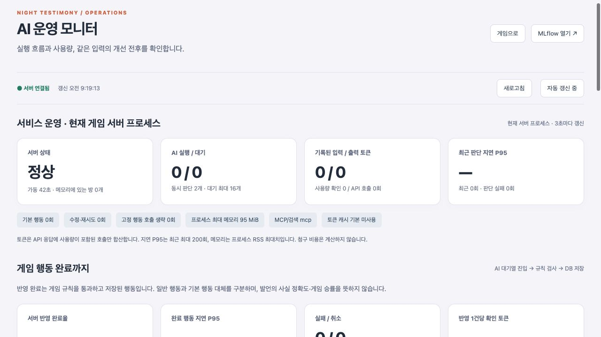

# Docker Compose 실행과 관리

G075 김지원 · 밤의 증언

가상환경 실행도 다른 사람이 Python·패키지·환경변수를 맞추면 재현할 수 있다. Docker는 Linux·Python·의존성·서비스 실행 설정을 묶어 설치 차이를 줄이는 방법이다. 각 PC의 데이터와 API 키는 별도이며, 같은 구성이라고 같은 게임 방·실험 기록·모델 출력이 공유되는 것은 아니다.

## 구성과 실행

Docker Desktop 또는 Docker Engine + Compose 2.24 이상을 사용한다. 기존 가상환경 방식은 계속 지원한다. 컨테이너 Python은 공식 3.12.14 이미지, Node는 프런트 파일 준비에만 사용한다. 기반 이미지는 다중 아키텍처 다이제스트로 고정하고 Python·npm 의존성은 lock 파일로 설치한다. OS·CPU 차이와 외부 모델의 비결정적 출력까지 동일해지는 것은 아니다.

저장소를 내려받아 루트에서 실행한다. `.env`가 없으면 `.env.example`을 복사해 본인의 키를 입력한다. 다른 사람에게 개인 키나 기존 `.env`를 전달하지 않는다.

```sh
# .env가 없을 때만 생성
[ -f .env ] || cp .env.example .env
# 키 입력 후
docker compose up -d --build --wait
docker compose ps
```

- 게임: http://127.0.0.1:8300
- 운영 모니터: http://127.0.0.1:8300/ops
- MLflow: http://127.0.0.1:5600

기존 가상환경 포트 8200/5500과 충돌하지 않는다. `.env`의 `DOCKER_GAME_PORT`, `DOCKER_MLFLOW_PORT`로 변경할 수 있다. `.env`가 없는 경우에도 설정은 유효하지만 실제 AI 게임에는 제공자 키가 필요하다.

게임 컨테이너가 FastAPI·정적 Vue 파일과 자식 프로세스인 stdio MCP 서버를 담당한다. MLflow는 별도 컨테이너로 동작하며 게임은 내부 주소 `http://mlflow:5500`으로 지표를 전송한다. 브라우저 링크는 호스트 포트 5600을 가리킨다. Node 개발 서버와 Ollama는 포함하지 않는다. 기본 구성은 OpenAI API이며, AI 없는 점검은 `GAME_PROVIDER=demo LANGSMITH_TRACING=false docker compose up -d --build --wait`로 실행한다.

## 운영 화면 접근

컨테이너로 전달된 요청은 실제 클라이언트 IP가 loopback이 아닐 수 있다. 따라서 IP 검사만 느슨하게 풀지 않고, 컨테이너 모드에서 운영 API에 별도 접근 키를 요구한다. 게임 참가자 인증과는 별개다.

```sh
docker compose exec game cat /app/runtime/ops-token
```

나온 값을 운영 화면에 입력한다. 이 키는 게임 데이터 볼륨에 권한 0600으로 생성되고 재시작 시 유지된다. 브라우저에서는 메모리에만 두므로 새로고침하면 다시 입력한다. API 키·운영 키는 이미지와 Git에 들어가지 않는다. Host·Origin·전달 헤더 검사는 유지한다. 가상환경의 기존 로컬 전용 모드는 키 없이 유지된다.

두 서비스의 호스트 포트는 127.0.0.1에만 바인딩된다. 이 구성은 개인 PC 재현용이며 LAN·인터넷 공개 배포 구성이 아니다. MLflow는 별도 사용자 인증을 추가하지 않았으므로 외부에 포트를 공개하지 않는다.

## 실행 관리와 데이터

```sh
docker compose logs --tail=100 -f game mlflow
docker compose stop
docker compose start
docker compose restart game
docker compose down
```

`game-data`에는 게임 DB·운영 접근 키, `mlflow-data`에는 실험 DB·아티팩트를 저장한다. `down` 후 다시 `up`해도 명명된 볼륨은 유지된다. `down -v`는 볼륨까지 삭제한다. 기존 가상환경의 `runtime/games.db`를 자동으로 옮기거나 공유하지 않는다. 동시에 같은 SQLite 파일을 양쪽에서 쓰지 않는다.

서버 재시작 때 진행 중이던 게임은 일시 중지 상태로 복원되고 방장이 재개한다. 이는 기존 서버 동작과 같다. 프로세스 내 최근 운영 지표는 초기화되지만, 전송 성공한 MLflow 기록은 유지된다.

게임 준비 상태는 DB·MCP 상태를 확인하는 `/health/ready`, MLflow는 `/health`로 검사한다. `service_started` 의존성을 사용해 MLflow가 아직 준비되지 않았거나 이후 장애가 나도 게임 기동을 막지 않는다. `up --wait`는 두 서비스의 준비까지 기다리므로 MLflow가 준비되지 않으면 명령이 실패할 수 있지만 게임은 이미 실행 중일 수 있다. exporter는 기존 유한 큐·실패 격리를 유지한다.

`restart: unless-stopped`는 프로세스 종료 시 재시작하는 정책이며, 단순히 unhealthy 표시가 됐다고 자동 복구하는 것은 아니다. 로그는 서비스별 10MB × 3개로 제한한다. 메모리·CPU 제한이나 여러 게임 서버 복제는 기본 적용하지 않는다. 방 상태·SQLite가 단일 서버 프로세스를 전제로 하므로 game을 여러 개로 scale하지 않는다.

게임 종료 유예는 기본 150초다. 실행 중 모델 호출을 정리하고 사용량을 저장할 시간을 준다. `GAME_DECISION_SECONDS`를 늘리면 `DOCKER_STOP_GRACE`도 판단 예산에 MCP·MLflow 종료 여유를 더해 늘린다. 강제 종료나 호스트 장애에서 마지막 작업 보존을 보장하는 설정은 아니다.

## 백업

```sh
mkdir -p runtime/docker-backup
docker compose stop
docker compose cp game:/app/runtime/games.db runtime/docker-backup/games.db
docker compose cp mlflow:/data/tracking.db runtime/docker-backup/tracking.db
docker compose start
```

DB 쓰기를 중단한 상태에서 복사한다. 아티팩트를 사용했다면 `/data/artifacts`도 별도로 복사한다. 복원은 대상 서비스를 중지하고 해당 볼륨에 DB를 넣은 뒤 소유권 10001:10001을 확인한다. 백업 폴더도 Git에서 제외한다.

## 검증 범위

2026-10-22 검증: macOS 가상환경 211개, Linux ARM64 / Python 3.12.14 컨테이너 211개 테스트 통과. 별도 규칙봇 Compose 프로젝트에서 Vue 제공, 운영 키 인증, 실제 MCP stdio 검색, 게임 규칙 적용·DB 저장, MLflow 지표 저장을 확인했다. MLflow를 중단해도 게임 행동이 진행되며, 재기동 후 지표 전송이 복구됐다. 게임 서버 재시작 후 방·참가자 인증·운영 키·MLflow 기록이 유지되고 프로세스 카운터만 초기화됐다.

[검증 기록](../reports/docker-verification-v1.json)에 범위를 명시했다. 외부 AI API 호출은 0회이며 실제 OpenAI 생성, AMD64 실행, 인터넷 공개 배포는 이번에 검증하지 않았다. Docker 자체가 모델 속도나 정답률을 높였다는 주장은 하지 않는다.

```sh
# 이미지 빌드 후 같은 Linux 단위·통합 테스트 실행. 호스트의 .env는 전달하지 않음.
docker run --rm --entrypoint python night-testimony-game:local -m unittest discover -s tests
```

참고: [Compose 시작·종료 순서](https://docs.docker.com/compose/how-tos/startup-order/), [Compose 서비스 설정](https://docs.docker.com/reference/compose-file/services/), [MLflow 네트워크 보안](https://mlflow.org/docs/latest/self-hosting/security/network/).


