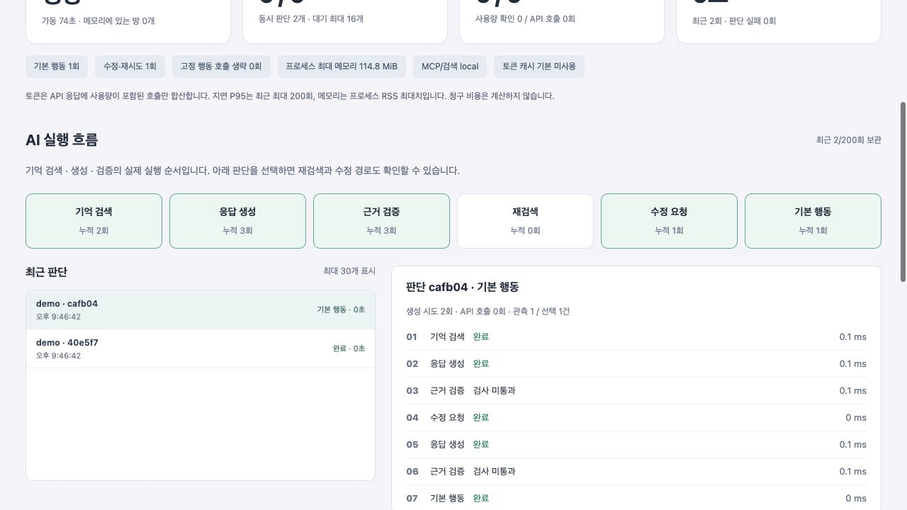
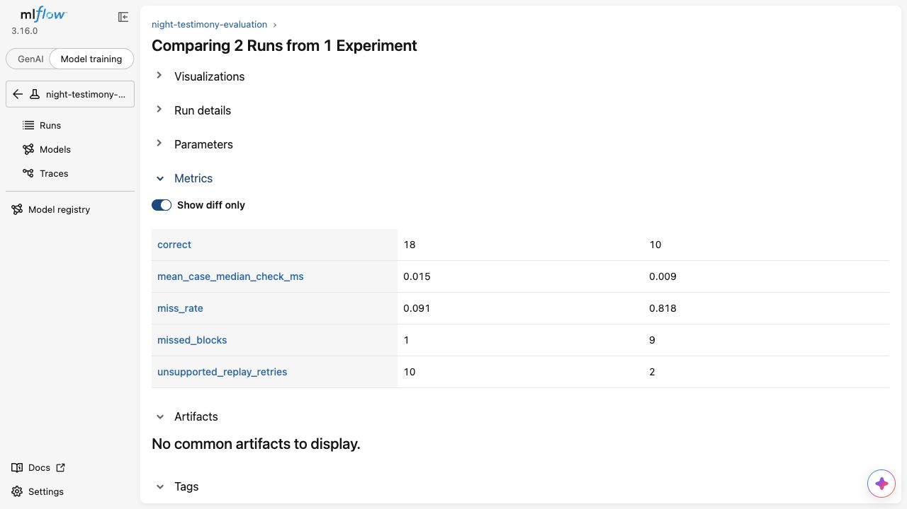

# 운영 화면과 MLflow

G075 김지원 · 밤의 증언

## 실행

게임 서버를 실행한 뒤 [운영 모니터](http://127.0.0.1:8200/ops)를 연다. 별도 프런트엔드 빌드는 필요 없다. `/api/ops`는 읽기 전용이며 3초마다 갱신한다. 원격 주소, 다른 Origin, 전달 프록시 헤더를 거부한다. 현재 구현은 개인 로컬 운영용이며 원격 운영에 사용할 관리자 인증은 아직 없다.

```sh
./run_web.sh
```

MLflow는 게임 환경과 분리한다. 아래 Python 3.12 환경이 필요하며, 패키지 버전은 `requirements-mlflow-lock.txt`에 고정했다.

```sh
uv venv --python 3.12 runtime/mlflow-venv
uv pip install --python runtime/mlflow-venv/bin/python -r requirements-mlflow-lock.txt
./run_mlflow.sh
```

`.env`에 `GAME_MLFLOW_TRACKING_URI=http://127.0.0.1:5500`을 설정하고 게임 서버를 재시작하면 운영 지표를 기록한다. 값을 비우거나 생략하면 MLflow 전송을 끈다. 서버는 `127.0.0.1:5500`에 바인딩하며 메타데이터는 `runtime/mlflow/tracking.db`에 저장한다. API 키는 필요하지 않다. 게임의 OpenAI 키는 기존 `.env`에서만 관리한다.

[MLflow](http://127.0.0.1:5500)에서 `Model training`의 `Runs`를 선택하면 숫자 지표를 볼 수 있다. 이 UI 이름이 모델을 새로 학습했다는 뜻은 아니다. 이번 연동은 REST 기반 실험·숫자 지표 기록이며 MLflow GenAI Trace를 자동 수집하는 설정은 추가하지 않았다. 상세 추적은 기존 LangSmith, 실행 단계 표시는 운영 페이지가 담당한다. Apache Airflow는 도입하지 않았다.

## 지표 범위

- 서버 상태, 가동 시간, 메모리에 있는 방 수, AI 실행 수와 대기 수.
- LangGraph 실제 콜백으로 수집한 기억 검색·생성·근거 검사·재검색·수정·기본 행동의 실행 순서와 시간.
- 프로세스 시작 이후 판단·재시도·기본 행동·실패 횟수. 실제 API 응답에 포함된 토큰만 합산하고 사용량 확인 호출 수를 함께 표시한다.
- 최근 최대 200회 판단의 P50/P95. 화면은 최근 30회만 보여준다. 단계를 최대 40개 보관하며 프롬프트·비공개 역할·발언·게임 ID를 수집하지 않는다.
- RSS는 현재값이 아닌 **프로세스 최대 사용량**이다. 캐시 상태는 설정값이며 적중률을 추정하지 않는다. 청구 금액도 추정하지 않는다.
- 프로세스 내 최근 기록은 재시작하면 초기화된다. MLflow는 별도 SQLite에 기록을 유지하지만 전송 성공한 숫자만 남는다.

토큰 캐시와 유효 기간이 있는 개인 판단은 기존 구현을 유지한다. 관측 콜백은 `set_config_context`로 요청별로 주입하므로 동결 평가에 사용한 `game/decision.py`는 수정하지 않았다. 기존 보류 평가 결과의 해시와 의미가 유지된다.

## MLflow 실패 처리

MLflow 클라이언트는 서버 시작 시 하나의 작업 스레드에서 생성해 재사용한다. 게임 스레드는 최대 64개 큐에 숫자만 넣고 즉시 진행한다. HTTP 제한 시간은 요청당 1.5초이며, 기록 실패 또는 큐 초과 시 누락 수를 늘린다. 무제한 재시도·메모리 축적을 하지 않는다. 연결은 약 10초 주기로 확인하며 종료 시 중지를 요청하고 최대 10초 동안 작업 스레드 종료를 기다린다.

이 방식은 게임 응답을 MLflow 장애와 분리하지만, 실패한 샘플을 영구 재전송하지 않으므로 지표가 빠질 수 있다. MLflow는 별도 프로세스와 DB, 패키지 설치 공간을 사용한다. 게임 프로세스 RSS에는 MLflow·MCP 프로세스 메모리가 포함되지 않는다. 장기 서비스에서는 보관 기간·삭제 정책, 관리자 인증, 다중 서버 집계가 필요하다.

## 평가 결과 기록

```sh
.venv/bin/python tools/log_evaluation_mlflow.py
```

`night-testimony-evaluation`에 보존된 합성 22건 평가의 `before`와 `after`를 기록한다. 입력·보고서 해시와 평가 조건을 함께 저장하고, 같은 보고서의 성공한 기록을 재실행해 중복 생성하지 않는다. 모델을 재호출하지 않는다. Run Duration은 결과를 등록한 시간이며 판단 지연이 아니다.

`night-testimony-runtime`은 실제 게임 서버의 실행 기록, `night-testimony-monitor-smoke`는 아래 검증용 기록이다. 서로 섞지 않는다.

## 기능 검증

```sh
.venv/bin/python -m unittest discover -s tests
node --check frontend/assets/ops.js
.venv/bin/python tools/monitor_smoke.py
```

마지막 명령은 게임 DB를 쓰지 않는 별도 `127.0.0.1:8201/ops` 서버다. 규칙봇 합성 입력으로 정상 경로와 검증 실패·수정·기본 행동 경로를 실제 LangGraph에서 실행한다. 외부 LLM 호출은 0회다. 종료는 터미널에서 Ctrl+C를 누른다.

실제 서버는 새 AI 판단이 없으면 0회와 빈 기록을 그대로 보여준다. 합성 기록을 실제 사용량처럼 넣지 않는다. UI는 데스크톱 1280px과 모바일 390px에서 확인했다.

## 확인 화면

[실제 서버 운영 화면](../reports/assets/ops-live-desktop.jpg)





MLflow 캡처는 왼쪽이 개선 후, 오른쪽이 이전이며 차이가 있는 지표만 표시한다. 정상 발언 오차단은 양쪽 3건으로 같아 이 필터에서 숨겨진다. 전체 수치는 [평가 보고서](../reports/claim-guard-scope-v2.md)에 있다.

참고: [MLflow Tracking Server](https://mlflow.org/docs/latest/self-hosting/architecture/tracking-server/), [REST API](https://mlflow.org/docs/latest/api_reference/rest-api.html).
