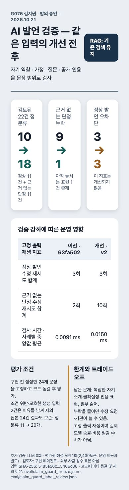

# 문장 범위 검증 v2 — 개발 회귀와 보류 평가

G075 김지원 · 밤의 증언 · 2026-10-21

## 문제와 개선

이전 검증기는 실제 의사의 자기소개와 가정문을 차단하고, `죽인 걸 직접 봤어` 같은 구어체 단정을 놓쳤다. 문장·절과 술어별 범위 검사, 실제 자기 역할 확인, 공개 인용의 화자·전문 대조를 추가했다. 기존 RAG, 벡터 DB 미사용 구조, 제한 재시도는 유지한다.

## 평가 절차

1. 구현 전 gpt-4.1-mini에 코드 없이 시나리오 24개를 전달해 발언을 생성했다. 예시 문장은 구현 중 읽지 않았다. 생성은 1회, 입력 1,821·출력 609·합계 2,430토큰이었다. 평가셋 작성 비용이며 게임 운영 토큰이 아니다.
2. 개발용 회귀 테스트만 사용해 수정한 뒤 전체 Python 테스트 186개를 통과했다.
3. 검증기·프롬프트·그래프 파일 해시와 평가 입력 해시를 기록해 동결했다.
4. 같은 관측과 고정 출력으로 이전 커밋 `63fa502` 및 현재 코드를 비교했다. 검증기는 사례당 10회 시간을 측정하고, 그래프는 같은 문장을 반복 출력하는 모의 클라이언트로 수정·기권 경로를 재생했다.
5. 코드 동결 후 생성 문장을 검토했다. 정상 자기소개에 근거 없는 과거 행동을 추가한 1건, 독립된 단정 대신 모호한 조건문을 만든 1건은 사전 시나리오와 달라 제외했다. 원본 24건과 최초 결과는 보존했으며 정답 라벨을 고치지는 않았다.
6. 평가에서 드러난 실패에 맞춰 v2 규칙을 다시 수정하지 않았다. 검토자는 구현 에이전트이며 외부 사람 검수·대표 표본·통계적 독립성을 주장하지 않는다.

## 같은 입력의 결과

| 지표 | 이전 | 개선 |
| --- | ---: | ---: |
| 검토된 입력 정분류 | 10/22 | 18/22 |
| 정상 발언 오차단 | 3/11 | 3/11 |
| 근거 없는 단정 누락 | 9/11 | 1/11 |
| 정상 발언 수정 재시도 합계 | 3 | 3 |
| 근거 없는 단정 수정 재시도 합계 | 2 | 10 |
| 정상 발언의 기본 행동 대체 | 3 | 3 |
| 검사 시간: 사례별 중앙값의 평균 | 0.0091 ms | 0.0150 ms |

제외 전 전체 24건은 정분류 11→20개, 정상 오차단 4→3개, 단정 누락 9→1개였다. 제외 전·후를 모두 공개한다. 검사 자체가 더 복잡해졌으며 속도 개선을 주장하지 않는다. 누락을 줄이면서 잘못된 출력에 수정 기회를 더 주므로 호출 비용이 늘 가능성이 있다.

고정 출력 재생에는 유료 모델을 호출하지 않았다. 잘못된 출력은 수정 요청 후에도 그대로 반복하므로 실제 LLM의 수정 성공률·비용·응답 지연을 나타내지 않는다. 입력 토큰이나 청구 금액 절감 수치로 해석하면 안 된다. 이번에는 생성기 모델과 검증기를 혼동하지 않도록 자료 생성 토큰을 별도로 표기한다.

## 결과 화면 캡처



## 남아 있는 실패

- 수식어가 긴 자기소개를 자기 역할 공개로 인식하지 못하는 경우.
- `판단하기 어렵습니다` 형태의 일부 불확실성 표현을 단정으로 처리하는 경우.
- 지원하는 화자/인용 문형과 다른 전달 문장을 차단하는 경우.
- `범인임에 틀림없어` 같은 아직 탐지하지 못하는 술어.

개발 회귀에서 알려진 자기소개·가정문 오류는 수정했지만 보류셋의 전체 정상 오차단 수는 줄지 않았다. 범용 한국어 의미 검증기로 표현하지 않는다. 전언을 사실로 승인하거나 여러 참가자 정보를 합쳐 판단하는 기능도 아니다.

## 벡터 DB 판단

현재 검색은 게임·참가자의 허용된 기록에서 관련 내용을 선택해 모델 문맥에 넣는 RAG다. 이번 문제는 검색 저장소가 아니라 생성 발언 검증에서 발생했다. 참가자가 5~11명이고 게임별 기록을 분리하는 현재 규모에서는 별도 벡터 DB를 추가하지 않는다. 데이터 규모·검색 누락·지연을 측정하고, 필요하면 의미 검색의 효과부터 비교한다. 벡터 검색 도입과 별도 벡터 DB 운영은 다른 선택이다.

## 재현 및 자료

```sh
.venv/bin/python -m unittest discover -s tests
.venv/bin/python -m game.evaluate_claim_guard --output runtime/verification/claim-guard-repeat.json
.venv/bin/python -m game.evaluate_claim_guard --review --output runtime/verification/claim-guard-review-repeat.json
```

기존 결과를 덮어쓰지 않는다. 새 결과 경로를 사용한다. 코드나 입력이 동결 해시와 달라지면 평가가 중단되며 새로운 실험 버전으로 분리해야 한다.

- [전체 24건 최초 결과](claim-guard-scope-v2.json)
- [검토된 22건 결과](claim-guard-reviewed-v2.json)
- [고정 입력](../eval/claim_guard_holdout.json), [코드·입력 동결](../eval/claim_guard_freeze.json), [제외 이유](../eval/claim_guard_label_review.json)
- [개발 회귀 테스트](../tests/test_claim_guard_scope.py), [검증기](../game/claim_guard.py)

평가 데이터는 합성 자료다. 실제 사용자 발언, 게임 DB, API 키는 포함하지 않는다. 발표자료와 대본 파일은 수정하지 않았다.
